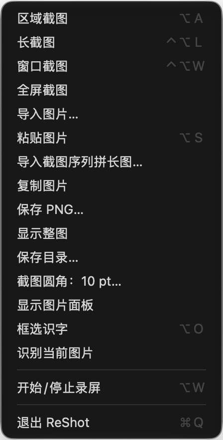
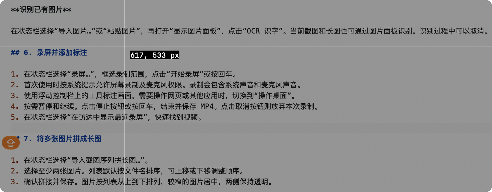
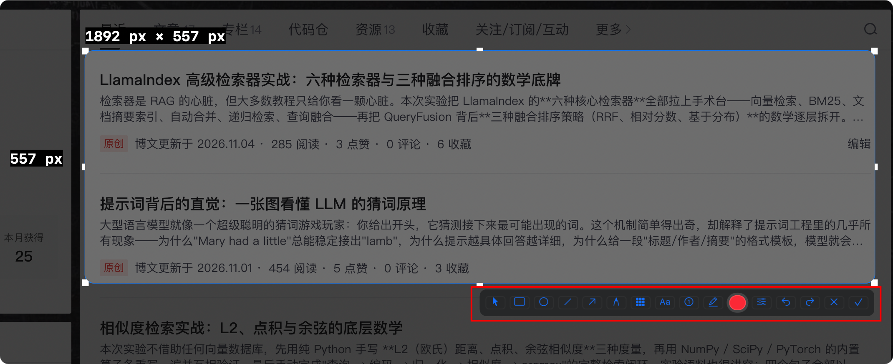

# 用一天时间和GPT一起做了个Mac 截图小工具：ReShot

一开始，我只是想要一款顺手的 Mac 长截图和OCR工具。

平时看到一段网页内容，想截成长图发给同事。遇到图片里的文字，希望框选一下就能复制。截图之后最好还能画个箭头、圈出重点，然后直接粘贴到聊天窗口。

这些操作听起来很日常，真正把它们组合成一个好用的 App，却需要考虑选区、滚动、图像拼接、文字识别、保存、权限和大量交互细节。这次，我决定拿熟悉的 iShot 作为功能参考，和Codex一起尝试做出一款自己的小工具,一整天时间,我们干成了。
先展示一下:

*开发过程截图，当前入口以文末使用说明为准。*

最后得到的成品叫 **ReShot**。它从截图、长截图和 OCR 出发，逐步增加了拼接长图、标注、录屏、系统声音和麦克风录制。打开之后，它安静地待在 Mac 菜单栏里，需要时按快捷键或点一下菜单就能使用。

这里记录整个制作过程，以及这款工具最终能做什么。文末附有一份简明使用说明。

## 从一个熟悉的产品开始

最初的想法很直接：参考 iShot 已有的使用体验，做出自己日常最常用的功能。第一阶段的重点是长截图和 OCR，随后明确了区域截图、窗口截图、全屏截图以及保存和粘贴的完整流程。

在和GPT的讨论中，需求逐渐变得具体。比如长截图，不能只说“把网页截成长图”，还需要回答许多实际问题：先框哪里？是否可以调整选区？手动滚还是自动滚？如果用户往上回看，再向下滚，会不会出现重复内容？到页面底部后，是自动保存还是等用户确认？

普通截图也是一样。我们希望看到像素尺寸，能拖动边线调整大小，画上标注后再确认。完成后图片直接保存，同时可以粘贴到其他应用。按下取消，就放弃这次截图。

把这些日常动作说清楚，GPT 才能围绕同一个目标开展工作。后续每一次操作反馈，也都成为下一轮调整的依据。

## GPT、REA 和 Ghidra 分别做了什么

整个过程中，我主要负责提出需求、操作应用和判断体验。GPT 在共享的项目工作区中整理需求、编写和调整代码、构建应用、运行验证，并根据实际使用结果继续迭代。

为了理解参考产品的功能路径，我们还使用了 **REA** 和 **Ghidra**。可以把 REA 理解成连接分析任务和工具的工作台，Ghidra 则帮助查看已编译程序中的结构与调用关系。分析集中在截图、滚动截图和 OCR 等相关入口，为理解功能提供线索(也仅仅是提供思路,并不能反编译还原源码,没那么神奇,这里着重说明)。

这一步看到的是程序分析结果，需要结合实际操作判断。项目记录了观察到的内容，也记录了尚未确认的部分。ReShot 的功能由项目独立实现，参考重点放在用户操作与功能体验上。相关过程保留在项目的[分析记录](./ishot-ghidra.md)中。

整个协作不是发出一句“做一个截图 App”之后等待结果。更像是不断交接任务：描述想法，确认范围，让 GPT 实现一个版本，再回到真实桌面试用，把具体操作和感受告诉它。部分需要系统授权或真实鼠标操作的环节，由我亲自完成并反馈。

## 第一阶段，让常用截图流程连起来

ReShot 最先围绕截图建立起一条完整路径。按下快捷键，屏幕上出现十字像素标线，拖出想要的区域，松开鼠标后就能看到工具栏。选区边线和角点可以继续调整，尺寸也会显示出来。

确认截图后，图片保存为 PNG，并写入剪贴板。接下来打开微信、邮件或文档，粘贴即可。想放弃时，按 Esc 或点击取消。除了区域截图，也可以选择一个窗口，或截取当前鼠标所在的整块屏幕。

*图为项目生成的离屏验证图，用于展示进入区域截图时的十字标线和像素位置。*

当基本流程能用之后，关注点从“有没有这个功能”转到了“使用起来顺不顺手”。例如，框选能否一次完成，工具栏是否占用太多空间，图片四角是否可以设置圆角，完成以后能否直接发出去。正是这些细节，让一款工具逐渐接近每天愿意打开使用的状态。

## 把一整页内容收进一张长图

长截图是这次最关注的功能之一。它适合保存网页教程、聊天记录和需要上下滚动才能看全的内容。

ReShot 提供两种方式。手动模式下，先框选内容区域，再自己滚动页面，预览会随着采集逐渐变长。自动模式下，切换到自动滚动，把鼠标放进选区，应用会按节奏滚动并采集。过程中可以暂停、继续，也可以在确认内容后点击“完成截图”。

实现这个流程，需要让应用理解连续画面之间的关系。每次滚动带来的新内容要接到前面的图片后面，重复的部分则需要处理。如果画面之间无法可靠接上，应用会暂停并提示用户调整，而不是悄悄输出一张顺序有问题的长图。

这个功能也经历了真实网页上的多轮试用。用户确认自动模式能够开始滚动，并且截图成功保存。最后的选择仍然留给使用者：看一眼预览，确定需要的内容已经收齐，再完成保存。

## 截图之后，直接标注和识字

截图的下一步往往是表达。比如在操作说明里用箭头指向按钮，在群聊里用矩形框出需要关注的数字，或给一段信息加上文字说明。

ReShot 在框选后提供悬浮标注栏，包含矩形、圆、直线、箭头、画笔、马赛克、文字、序号和高亮等工具。颜色与粗细可以调整，也可以撤销和重做。需要修改选区时切回选择工具，再移动选区或调整边角。标注完成后点击 ✓，保存和复制的图片都会包含标注。

*图为项目生成的离屏验证图，展示选区、矩形标注和悬浮工具栏。*

OCR 则解决另一种常见需求。看到图片里的中文或英文，选择“框选识字”，或者导入已有图片后点击“OCR 识字”，就能得到可编辑的文本。识别结果可以复制、合并换行，也可以导出为 TXT。长图同样可以识别，文字识别在本机完成。

## 需求继续生长，录屏也加入了 ReShot

当截图和标注已经可以满足基本需求，新的想法出现了：操作过程能否直接录下来？于是项目从静态图片延伸到了视频。

录屏同样从框选区域开始。开始后，选区以蓝色细虚线和四角标识提示范围，控制面板提供标注、暂停、继续、停止保存和取消。录制操作教程时，可以一边演示，一边圈出画面中的重点。

用户还提出了一个贴近日常使用的细节：如果圈住网页里的某一段文字，再滚动页面，标注应该跟着这段文字移动。当目标滚出画面或无法继续可靠匹配时，标注会被清除。实际复测确认了标注随可见对象移动和消失的效果。遇到相似画面或遮挡时，标注也可能提前消失。

录屏最终支持同时采集系统声音和麦克风。比如演示一个软件操作时，既可以录下应用发出的声音，也可以同步讲解。用户现场确认了双路声音、暂停继续、停止保存和取消操作。完成的视频保存为 MP4，方便回看和分享。

## 一整天里，应用是怎么一步步成形的

回看这次过程，需求一直在变得更具体。

起初关心的是“能否截长图、识别文字”。接下来开始关注选区尺寸、边线调整、自动保存与粘贴。再往后，重点转向标注栏是否好用、自动滚动是否顺手、录屏时按钮放在哪里、声音是否完整，以及标注能否跟随正在滚动的内容。

每一次反馈都尽量描述实际操作。比如“确认选区后切换自动滚动”“录屏时圈住一段文字，然后滚动页面”。GPT 根据这些场景调整实现，再由使用者在真实桌面操作。代码测试和现场体验一起推动版本前进。

一天结束，ReShot 已经从一组核心需求，长成了一个可以日常使用的 Mac 工具。它的价值也体现在使用细节里：一次快捷键框选，一次确认完成保存和复制，需要时还能直接识字、拼长图或录一段演示。

---

# ReShot 2.1 简明使用说明

## 功能一览

- **截图**：区域、窗口和当前鼠标所在显示器的全屏截图，支持显示像素尺寸和调整选区。
- **图片标注**：矩形、圆、直线、箭头、画笔、马赛克、文字、序号和高亮，支持颜色、粗细及撤销重做。
- **长截图**：手动或自动滚动采集，支持暂停、继续和完成后保存。
- **OCR 识字**：框选屏幕文字，或识别当前图片、导入图片及长图中的简体中文、繁体中文和英文。
- **区域录屏**：录制屏幕画面、光标、系统声音与麦克风，支持实时标注和暂停继续。
- **图片序列拼接**：选择多张现有图片，调整顺序后纵向拼接。
- **保存与分享**：截图可保存为 PNG、JPEG 或 TIFF 并复制到剪贴板，录屏保存为 MP4。

## 1. 首次启动与权限

打开项目中的 `dist/ReShot.app`。启动后，点击 macOS 屏幕顶部的 **ReShot 状态栏图标**，即可看到各功能入口。图片面板默认隐藏，需要查看时在菜单中选择“显示图片面板”。

ReShot 需要 macOS 13 或更新版本。首次使用时，根据系统提示授予所需权限。

- **屏幕与系统音频录制权限**用于截图、长截图和录屏时获取画面及系统声音。
- **辅助功能权限**用于长截图的自动滚动。手动滚动长截图仍可使用。
- **麦克风权限**用于录屏时采集麦克风声音。

截图和录屏默认保存到 `~/Pictures/ReShot`，也就是当前用户的“图片/ReShot”文件夹。

## 2. 区域、窗口和全屏截图

**区域截图**

1. 按 `Option + A`，或在状态栏选择“区域截图”。
   
2. 按住鼠标拖出区域，查看显示的像素尺寸。松开鼠标后恢复系统箭头。选择工具下可拖动边线、角点或尺寸标签调整选区。
   
3. 按需要添加标注，点击 ✓ 或按回车确认。截图保存后可直接粘贴到其他应用。
4. 想放弃本次截图时，按 Esc 或点击 ×。

**窗口截图**

按 `Control + Option + W`，或选择“窗口截图”。将鼠标移到目标窗口并点击，随后在标注面板中确认或取消。窗口截图默认不包含阴影。

**全屏截图**

把鼠标移到要截取的显示器，按 `Control + Option + F` 或点击状态栏中的“全屏截图”，在标注面板中确认。截图将覆盖该显示器的画面。

## 3. 给截图添加标注

框选区域后，在悬浮工具栏选择矩形、箭头、画笔、文字等工具，在图片上绘制。使用取色和粗细控件调整样式，使用撤销或重做修改操作。

绘制时选区会固定。需要移动或缩放选区时，先切回**选择工具**。完成后点击 ✓ 保存并复制。选择 × 则取消本次截图。

## 4. 截取长图(非常实用)

1. 打开要截取的网页或其他滚动内容，按 `Control + Option + L`，或选择“长截图”。
2. 框选需要滚动的内容区域，调整大小后确认。
3. 手动模式下，在选区内滚动页面。也可以切换“自动滚动”，授权辅助功能后把鼠标移入选区。
4. 根据需要暂停或继续，查看增长的预览。内容采集完成后点击“完成截图”，生成的长图会保存并复制。

如果界面提示画面未接上，可稍微向上回滚，等内容重新接上再继续。页面有固定导航栏或动画时，适当缩小选区有助于采集。

## 5. 识别图片中的文字

**识别屏幕上的文字**

1. 按 `Option + O`，或点击状态栏菜单中的「框选识字」。
2. 框选文字区域并确认，等待识别完成。
3. 在结果中编辑文字、复制、合并换行或导出 TXT。

**识别已有图片**

在状态栏选择“导入图片…”，或按 `Option + S` 从剪贴板载入图片。按 `Control + Option + O`，或点击图片面板上的“OCR 识字”。当前截图和长图也可通过图片面板识别。识别过程中可以取消。

## 6. 录屏并添加标注(这是一项创新应用)

1. 按 `Option + W` 或在状态栏选择「开始/停止录屏」，框选录制范围，点击「开始录屏」或按回车。
2. 首次使用时按系统提示允许屏幕录制及麦克风权限。录制会包含系统声音和麦克风声音。
3. 使用浮动控制栏上的工具标注画面。需要操作网页或其他应用时，切换到“操作桌面”。
4. 按需暂停和继续。再次按 `Option + W`、点击停止按钮或按回车，结束并保存 MP4。点击取消按钮则放弃本次录制。
5. 在状态栏选择“在访达中显示最近录屏”，快速找到视频。

## 7. 将多张图片拼成长图(非常实用)

1. 在状态栏选择“导入图片拼图”。
2. 选择至少两张图片。列表默认按文件名排序，可上移或下移调整顺序。
3. 确认拼接并保存。图片按列表从上到下排列，较窄的图片居中，两侧保持透明。

## 8. 偏好设置

在状态栏选择“偏好设置…”，可分别指定图片和视频目录，选择图片保存格式，并设置截图圆角。默认圆角为 10 pt，设为 0 即使用直角。

勾选「显示整图」可让图片缩放到面板内，选择会在下次启动时保留。点按功能旁的快捷键按钮可录入新组合键，按 Esc 取消修改。需要随系统登录启动时，勾选「登录时打开 ReShot」。

## 9. 最后附上App下载地址
ReShot https://download.csdn.net/download/lnpusky/93821974

欢迎Mac用户下载使用,纯绿色小工具,方便快捷且免费,使用时在 「隐私与安全」->安全性->大胆放行即可。

**切勿用于商业目的；关注我后续更新迭代**